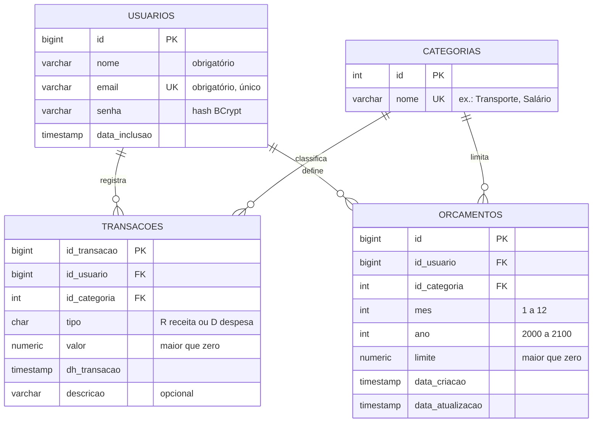

# FinPlan — API (fin-back)

API do planejador financeiro pessoal, feita em Spring Boot 4 (Java 21) com banco PostgreSQL. A interface fica no repositório [fin-front](https://github.com/HENR1QUEF0NSECA/fin-front), que usa esta API.

## 🚀 Como rodar o projeto

### O que precisa estar instalado

- [Git](https://git-scm.com/downloads)
- [Docker Desktop](https://www.docker.com/products/docker-desktop/), aberto e rodando. No Windows, o instalador ativa o WSL 2 se precisar e pode pedir para reiniciar o computador.

Não precisa instalar Java, Gradle nem PostgreSQL: eles rodam dentro do Docker. Na primeira vez é preciso internet, porque as dependências são baixadas automaticamente.

### Passo a passo

Os comandos funcionam no PowerShell, no Git Bash, no macOS e no Linux.

**1. Clone o repositório**

```bash
git clone https://github.com/HENR1QUEF0NSECA/fin-back.git
cd fin-back
```

**2. Crie o arquivo `.env`**

```bash
cp .env.example .env
```

O `.env` guarda a senha do banco e o segredo do JWT. Os valores de exemplo já funcionam para rodar localmente. (No Prompt de Comando do Windows, use `copy` no lugar de `cp`.)

**3. Suba a API e o banco**

```bash
docker compose up -d --build
```

Na primeira vez, o Docker baixa a imagem do PostgreSQL e a do Gradle com Java 21, baixa as dependências da API e compila tudo. Isso leva alguns minutos; nas próximas vezes é bem mais rápido.

**4. Confira se a API subiu**

Abra http://localhost:8080/api/categorias no navegador. Deve aparecer `{"status":401,"erro":"Token não fornecido",...}`. Esse 401 é o esperado, porque a rota exige login.

Pronto: a API responde em `http://localhost:8080/api`. Para usar o sistema pela interface, siga agora o [README do fin-front](https://github.com/HENR1QUEF0NSECA/fin-front#readme).

### Conta de demonstração

Na primeira vez que a API sobe, ela cria uma conta já preenchida com os últimos 3 meses de receitas, despesas e orçamentos, para ver o sistema funcionando sem cadastrar nada:

| E-mail | Senha |
|---|---|
| `demo@finplan.local` | `demo1234` |

Os dados são gerados a partir da data do dia, então o mês atual sempre tem lançamentos. Se a conta já existir, nada é alterado.

### Parar e rodar de novo

| Para | Comando (dentro da pasta `fin-back`) |
|---|---|
| Parar a API e o banco | `docker compose down` (os dados ficam guardados) |
| Rodar de novo | `docker compose up -d` |
| Atualizar depois de um `git pull` | `docker compose up -d --build` |
| Ver os logs da API | `docker compose logs app` |

### Se algo der errado

| Problema | Solução |
|---|---|
| `docker` não é reconhecido, ou erro ao conectar no Docker | Abra o Docker Desktop e espere ele indicar que está rodando |
| Erro de porta na 5432 (`port is already allocated` ou `ports are not available`) | Já existe um PostgreSQL usando essa porta no seu computador. No `.env`, troque para `POSTGRES_PORT=5433` e rode `docker compose up -d` de novo |
| Erro de porta na 8080 | Feche o programa que está usando a 8080 e rode `docker compose up -d` de novo |
| A API não responde no passo 4 | Veja o erro com `docker compose logs app` |

## ⚙️ Configuração (`.env`)

| Variável | Padrão | Para quê |
|---|---|---|
| `DB_PASSWORD` | `troque-esta-senha` | Senha do PostgreSQL |
| `JWT_SECRET` | segredo de exemplo | Segredo que assina os tokens (mínimo de 32 caracteres) |
| `POSTGRES_PORT` | `5432` | Porta do banco no seu computador |
| `DB_USERNAME` | `postgres` | Usuário do PostgreSQL |
| `DB_URL` | `jdbc:postgresql://localhost:5432/finance` | Endereço do banco, usado só ao rodar sem Docker |
| `JWT_EXPIRATION` | `86400000` | Validade do token em milissegundos (24 horas) |

O `.env` fica fora do Git. Num deploy de verdade, troque a senha e o segredo.

## 🔧 Rodar a API sem Docker

Opcional, para quem prefere rodar a API direto no computador.

1. Instale o [JDK 21](https://adoptium.net/temurin/releases/?version=21) e o [PostgreSQL 16](https://www.postgresql.org/download/). O Gradle não precisa: o `gradlew` baixa sozinho, junto com as dependências, na primeira execução.
2. Crie o banco, conectado como o usuário `postgres` (no `psql`, pgAdmin ou DBeaver):
   ```sql
   CREATE DATABASE finance;
   ```
   As tabelas e as categorias são criadas pela própria API.
3. Crie o `.env` (`cp .env.example .env`) e coloque no `DB_PASSWORD` a senha do usuário `postgres` do seu PostgreSQL.
4. Rode, a partir da pasta `fin-back`:
   ```bash
   ./gradlew bootRun
   ```
   No Windows: `.\gradlew.bat bootRun`. A API sobe em `http://localhost:8080`.

## 🧪 Testes automatizados

São 49 testes, que rodam sem PostgreSQL e sem `.env` (usam um banco H2 em memória):

```bash
./gradlew test
```

No Windows: `.\gradlew.bat test` (precisa do JDK 21). Sem JDK, rode pelo Docker:

```bash
docker run --rm -v "${PWD}:/app" -w /app gradle:8-jdk21-alpine gradle test --no-daemon
```

## 🗂️ Modelo de dados

São quatro tabelas no PostgreSQL. Cada usuário tem as próprias transações e orçamentos, e as categorias são compartilhadas por todos.



| Relacionamento | Cardinalidade |
|---|---|
| Usuário → Transações | 1 usuário tem 0 ou mais transações; cada transação é de 1 usuário |
| Usuário → Orçamentos | 1 usuário tem 0 ou mais orçamentos; cada orçamento é de 1 usuário |
| Categoria → Transações | 1 categoria classifica 0 ou mais transações; cada transação tem 1 categoria |
| Categoria → Orçamentos | 1 categoria aparece em 0 ou mais orçamentos; cada orçamento tem 1 categoria |

Um usuário só pode ter um orçamento por categoria em cada mês (restrição única em `id_usuario`, `id_categoria`, `mes` e `ano`). As tabelas e as categorias são criadas pela própria API na primeira execução.

## 📡 Endpoints da API

Só o login e o cadastro funcionam sem token. Nas outras rotas, envie o token devolvido pelo login no header `Authorization: Bearer <token>`. O arquivo [requests.http](./requests.http) tem exemplos prontos de todas as rotas (extensão REST Client do VS Code).

| Método | Rota | O que faz |
|---|---|---|
| POST | `/api/auth/registro` | Cadastra um usuário |
| POST | `/api/auth/login` | Faz login e devolve o token |
| GET | `/api/usuarios/me` | Dados do usuário logado |
| GET | `/api/categorias` | Lista as categorias |
| GET, POST | `/api/transacoes` | Lista e cria transações |
| PUT, DELETE | `/api/transacoes/{id}` | Altera e exclui uma transação |
| GET | `/api/transacoes/tipo/{tipo}` | Filtra por tipo (`R` receita, `D` despesa) |
| GET | `/api/transacoes/categoria/{categoriaId}` | Filtra por categoria |
| GET | `/api/transacoes/mes?mes=&ano=` | Filtra por mês |
| GET | `/api/transacoes/periodo?inicio=&fim=` | Filtra por período (`AAAA-MM-DD`) |
| GET | `/api/transacoes/dashboard/resumo?mes=&ano=` | Totais do mês e divisão por categoria |
| GET | `/api/transacoes/dashboard/evolucao?ano=` | Receitas e despesas mês a mês |
| GET, POST | `/api/orcamentos` | Lista e cria orçamentos |
| GET, PUT, DELETE | `/api/orcamentos/{id}` | Busca, altera e exclui um orçamento |
| GET | `/api/orcamentos/mes?mes=&ano=` | Orçamentos de um mês |
| GET | `/api/orcamentos/categoria/{categoriaId}/mes?mes=&ano=` | Orçamento de uma categoria no mês |

Ao criar ou alterar uma transação, o campo `data` (`AAAA-MM-DD`, entre 01/01/2000 e hoje) é opcional: sem ele, a transação é criada com a data de hoje, e na alteração a data continua a mesma.

Os erros sempre vêm no mesmo formato, com a mensagem em português e, nos erros de validação, uma mensagem por campo:

```json
{
  "status": 400,
  "erro": "Dados inválidos",
  "campos": { "valor": "Valor deve ser maior que zero" },
  "timestamp": "2026-11-14T10:30:00"
}
```
